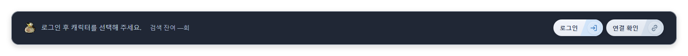
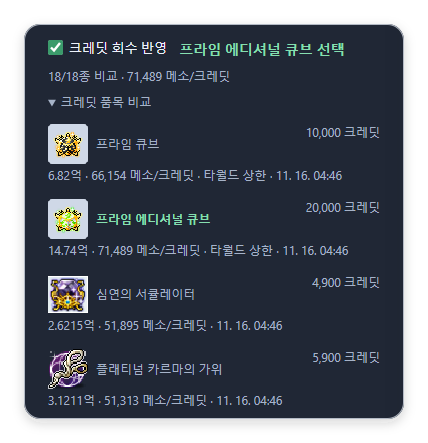

   
  

화면의 캐릭터·가격·검색 잔여 횟수는 사용법 설명을 위한 예시입니다.

캐시 아이템 판매·메소마켓·메포 선물식의 **현금 회수율**을 비교하는 앱입니다.
충전 할인율과 경매장 수수료를 반영해, 쓴 현금에서 얼마나 회수할 수 있는지 보여 줍니다.

## 사용법

### 1. 설치하고 로그인하기

위 다운로드 버튼으로 설치 파일을 받아 실행합니다.
설치가 끝나면 바탕화면의 **딸깍엠작**을 켜 주세요.

오른쪽 위 **로그인**을 누른 뒤, 열린 경매장 창에서 로그인하고 사용할 캐릭터를 선택합니다.
연결되면 경매장 창이 숨겨지고 대시보드로 돌아옵니다.
자동으로 연결되지 않으면 **연결 확인**을 눌러 주세요.

### 2. 내 조건 입력하기

  
   
  
<strong>메소 현금 시세</strong> 1억 메소당 현금 가격. 예: 1,400원. 
  <strong>캐시 충전 할인율</strong> 실제 충전 할인율. 예: 7%. 
  <strong>MVP 수수료</strong> 수수료 3%면 켜고, 5%면 끕니다. 
  <strong>메소마켓 기준 매수가</strong> 조회 시 <a href="https://maplechart.com/mesomarket.html">메차트</a> 매수가로 갱신됩니다. 
  <strong>메포 선물식</strong> 1만 메포 선물로 받는 현금 가격입니다.

   

### 3. 시세 조회하고 비교하기

  
   
  
<strong>시세 조회</strong> 본인 서버 호가·최근 3일 체결을 확인합니다. 
  <strong>정렬·더보기</strong> 열 제목으로 정렬하고, <strong>더보기 +</strong>로 펼칩니다. 
  <strong>크레딧 회수 반영</strong> 체크하면 선택된 품목의 회수액을 더합니다. 
  <strong>검색 횟수</strong> 전체 조회는 기본 32회이며 재시도는 추가 차감됩니다.

   

크레딧 품목은 체크 여부와 관계없이 함께 조회합니다.
입력값 변경·정렬·체크에는 검색 횟수를 사용하지 않습니다.

조회 제한이나 화면 표시가 궁금하면 [자주 묻는 질문](docs/FAQ.md)을 참고해 주세요.

## 업데이트

**앱을 켜면 새 버전 확인과 다운로드는 자동으로 진행됩니다. 설치는 다운로드가 끝난 뒤 앱을 종료할 때 진행됩니다.**

- **지금 적용:** ‘준비 완료’가 뜨면 **종료하고 업데이트**를 누르세요. 앱을 닫고 설치한 뒤 다시 실행합니다.
- **나중에 적용:** 계속 사용하다가 앱을 닫으면 자동으로 설치됩니다. 다음에 켤 때 새 버전으로 실행됩니다.

**업데이트 확인**은 앱을 켜 둔 동안 새 버전이 나왔는지 다시 확인할 때 쓰는 버튼입니다.

표시된 가격에 실제로 판매된다는 보장은 없습니다. 체결 내역도 함께 확인해 주세요.

NEXON 공식 앱이 아닙니다. 메이플스토리 아이템 이미지의 권리는 NEXON에 있습니다.
