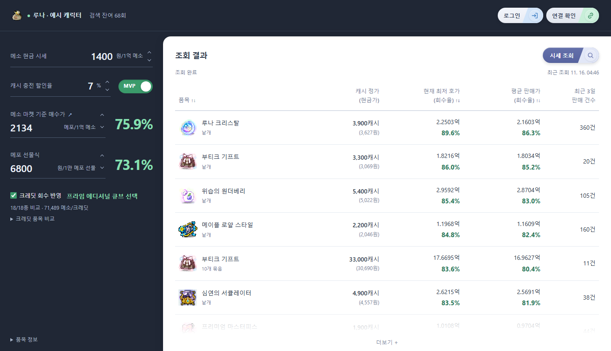
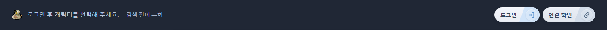
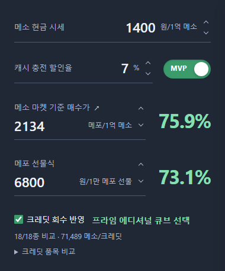
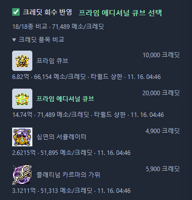

  

  

  Windows 64비트 · 정식 버전 <strong>1.0.3</strong>

  <a href="#사용법">사용법</a> ·
  <a href="docs/FAQ.md">자주 묻는 질문</a> ·
  <a href="https://github.com/9root3/maple-mvp-releases/releases">변경 내역</a>

화면의 캐릭터·가격·검색 잔여 횟수는 사용법 설명을 위한 예시입니다.

엠작할 때 어떤 품목을 팔아야 덜 손해 보는지 비교하는 앱입니다.
캐시 아이템 판매, 메소마켓 환전, 메포 선물식의 **현금 회수율**을 한 화면에서 볼 수 있습니다.

회수율은 **실제로 쓴 현금 대비 돌려받는 금액**입니다.
충전 할인율과 경매장 수수료를 반영하며, 숫자가 높을수록 좋습니다.

## 사용법

### 1. 설치하고 로그인하기

위 다운로드 버튼을 누르고, 열린 릴리스의 **Assets**에서
`Maple-MVP-버전-win-x64.exe`를 받아 실행합니다.
설치가 끝나면 바탕화면의 **딸깍엠작**을 켜 주세요.

오른쪽 위 **로그인**을 누른 뒤, 열린 경매장 창에서 로그인하고 사용할 캐릭터를 선택합니다.
연결되면 경매장 창이 숨겨지고 대시보드로 돌아옵니다.
자동으로 연결되지 않으면 **연결 확인**을 눌러 주세요.

### 2. 내 조건 입력하기

| 입력 | 넣을 값 |
| --- | --- |
| 메소 현금 시세 | 1억 메소당 현금 가격 |
| 캐시 충전 할인율 | 실제로 할인받는 비율. 할인 없이 충전하면 0% |
| MVP | 경매장 수수료 3%를 적용받으면 켜고, 일반 5%면 끕니다. |
| 메소 마켓 기준 매수가 | 1억 메소를 사는 데 드는 메포. 시세 조회 때 메차트 값으로 갱신됩니다. |
| 메포 선물식 | 1만 메포를 선물할 때 받는 현금 가격 |

입력값을 바꾸면 회수율은 바로 다시 계산됩니다. 이때 검색 횟수는 사용하지 않습니다.

### 3. 시세 조회하고 비교하기

**시세 조회**를 누르면 본인 서버의 최저 호가와 최근 3일 체결 내역을 가져옵니다.
품목명·현재 최저 호가·평균 판매가 제목을 누르면 정렬 방향이 바뀌고,
아래 **더보기 +**를 누르면 나머지 품목도 볼 수 있습니다.

크레딧샵 품목도 체크 여부와 관계없이 함께 조회·저장합니다.
**크레딧 회수 반영**을 켜면 크레딧당 회수액이 가장 높은 품목을 골라 회수율에 더합니다.
체크·해제를 반복해도 추가 검색은 하지 않습니다.

## 검색 횟수와 저장 시세

현재 전체 조회는 정상 완료 기준 **32회**를 사용합니다.
중복을 합친 19종의 호가 조회 19회와 캐시 13종의 체결 조회 13회입니다.
같은 품목의 캐시·크레딧, 낱개·묶음은 검색 결과를 나눠 씁니다.
실패 후 재시도에는 추가 횟수가 들 수 있습니다.

잔여 20회 이하에서는 알림을 띄우고 계속 진행합니다.
잔여가 부족하면 가능한 품목까지만 조회하며, 나머지는 저장된 시세를 유지합니다.
앱을 다시 켜도 같은 계정·서버·캐릭터로 연결하면 저장 시세를 불러옵니다.

표본 평균, 주의 표시, 메차트 조회 문제는 [자주 묻는 질문](docs/FAQ.md)에 정리해 두었습니다.

## 업데이트

새 버전이 있으면 앱에서 내려받습니다. **종료하고 업데이트**로 적용할 수 있고,
직접 확인하려면 앱 아래의 **업데이트 확인**을 누르면 됩니다.
품목 목록은 앱에서 자동으로 갱신합니다.

버전은 [SemVer 규칙](docs/VERSIONING.md)으로 붙입니다.
오류 수정은 `1.0.4`, 새 기능 추가는 `1.1.0`처럼 변경 내용에 맞춰 올립니다.

## 참고

- 표시된 회수율은 입력한 현금 시세와 조회한 호가·체결가로 계산한 값입니다. 실제 판매 가격이나 수익을 보장하지 않습니다.
- 경매장 요청과 저장 시세 처리는 각 사용자 PC에서 이뤄집니다. 계정과 조회 결과를 중앙 서버로 수집하지 않습니다.
- 설치 파일에는 코드 서명이 없어 Windows에서 게시자 확인 경고가 나올 수 있습니다. 이 저장소의 릴리스에서 받은 파일인지 확인해 주세요.
- NEXON 공식 앱이 아닙니다. 메이플스토리 아이템 이미지의 권리는 NEXON에 있습니다.
